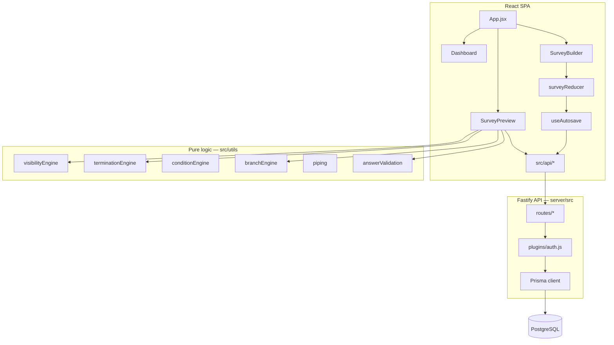

# Rescope Surveys

Browser-based survey authoring and delivery platform for market research and CX teams. React SPA with an optional Fastify/Prisma/PostgreSQL backend — same codebase supports **offline localStorage mode** and **multi-tenant API mode**.

---

## Tech stack


| Layer          | Technology                                                       |
| -------------- | ---------------------------------------------------------------- |
| **Frontend**   | React 18, Vite 5, Tailwind CSS 3, @dnd-kit, Lucide React         |
| **State**      | React `useReducer` + `surveyReducer`; debounced autosave hook    |
| **Backend**    | Fastify 5, @fastify/jwt, @fastify/cors, bcrypt                   |
| **Database**   | PostgreSQL 16, Prisma 6                                          |
| **Deploy**     | Docker Compose (nginx + API + Postgres), multi-stage Dockerfiles |
| **Load tests** | k6 against a Compose stack capped at 2 CPU / 4 GB                |
| **Tests**      | Node.js built-in test runner (`node --test`)                     |


---


## Runtime modes

Controlled by `VITE_USE_API` at build time (`src/config/api.js`):


| Mode                    | `VITE_USE_API`  | Persistence            | Auth                                                                  |
| ----------------------- | --------------- | ---------------------- | --------------------------------------------------------------------- |
| **Local** (default dev) | unset / `false` | Browser `localStorage` | Plain-text credentials in `localStorage`                              |
| **API** (production)    | `true`          | PostgreSQL via Fastify | HttpOnly access/refresh cookies; session metadata in `sessionStorage` |


Both modes share the same React UI, logic engines, and question type registries. Store modules (`authStore`, `surveyLibrary`, `responseStore`, `dncStore`, `platformStore`) branch internally on `useApi`.

Vite dev server proxies `/api` → `http://127.0.0.1:3003` (`vite.config.js`). Docker nginx does the same in production (`docker/nginx.conf`).

---


## Architecture

The codebase separates **authoring** (builder), **delivery** (taker), **pure logic** (utils engines), and **persistence** (localStorage or API layer). Question types use a **registry pattern**: one canonical list in `questionHelpers.js` drives parallel builder editor and taker renderer registries.




### Design principles

1. **Single source of truth** — `questionHelpers.js` defines question types; builder and taker registries must stay in sync (`npm run check:registries`).
2. **Pure logic in utils** — visibility, termination, conditions, branching, and piping are evaluated outside React components.
3. **Shared condition model** — `conditionEngine` powers visibility rules, termination blocks, branch rules, and external redirects.
4. **Live role enforcement** — JWT is verified per request, then the user's role is re-read from the database (not trusted from the token snapshot).
5. **Optimistic concurrency** — survey PATCH uses a monotonic `revision` counter; autosave serializes writes to avoid conflicts.
6. **Dual-mode stores** — persistence helpers abstract localStorage vs API so UI code stays mode-agnostic.

---


## Repository layout

```
survey-builder/
├── src/                    React SPA
│   ├── App.jsx             Routing, auth gate, lazy-loaded views
│   ├── api/                Thin fetch wrappers per domain (surveys, responses, dnc, billing, …)
│   ├── components/
│   │   ├── auth/           Login
│   │   ├── dashboard/      Survey library, platform settings, billing, team
│   │   ├── builder/        SurveyBuilder, editors, items, panels, test-runner
│   │   ├── taker/          SurveyPreview, question renderers, screens
│   │   ├── shared/         ConditionBuilder, RichTextEditor, NavigationLockEditor, …
│   │   └── ui/             Primitives (Modal, Toast, loaders)
│   ├── config/             Feature flags (`api.js`)
│   ├── constants/          Survey defaults, navigation lock, auth copy
│   ├── hooks/              useAutosave, usePageNavigationLock
│   ├── store/              ID generator, factories, initialState, surveyReducer
│   └── utils/              Engines, CSV export, persistence helpers
├── server/
│   ├── src/
│   │   ├── app.js          Fastify bootstrap, route registration
│   │   ├── plugins/        Prisma, JWT auth hook
│   │   ├── routes/         REST handlers (auth, surveys, public, dashboard, …)
│   │   └── lib/            Authz, seed, billing, survey public paths, normalization
│   └── prisma/             Schema and migrations
├── shared/                 Cross-package utilities (surveyUrl, matrixAnswer)
├── scripts/                Dev, deploy, load, check, and tests (unit + integration)
├── docker/                 nginx config for the web container + host Caddyfile template
├── k6/                     Load test script + Docker stats sidecar
├── docs/                   Module reference, smoke checklist, deploy guide
├── docker-compose.yml      Full stack (Postgres + API + web)
├── docker-compose.prod.yml VPS override — publish web on 127.0.0.1 only
├── docker-compose.load.yml 2 CPU / 4 GB limits + k6 runner
├── Dockerfile              Production web image (VITE_USE_API=true)
└── vite.config.js          Aliases (@/, @shared/), API proxy, code splitting
```


### Path aliases


| Alias      | Resolves to |
| ---------- | ----------- |
| `@/`       | `src/`      |
| `@shared/` | `shared/`   |


---


## Frontend implementation


### Routing

Hash-based SPA routing (`src/utils/appRoute.js`):


| Route           | View             | Auth     |
| --------------- | ---------------- | -------- |
| `#/`            | Dashboard        | Required |
| `#/builder/:id` | Survey builder   | Required |
| `#/preview/:id` | Internal preview | Required |
| `#/take/:id`    | Public taker     | None     |


**White-label path URLs** also resolve on `surveys.{clientDomain}/{publicPath}` (no hash). Client domain is parsed from the hostname; the path slug maps to `survey.publicPath` in the database.

Views are lazy-loaded with route prefetching (`src/utils/routePrefetch.js`) to reduce initial bundle size. Question type components are loaded on demand via dynamic import registries.

### Builder state

- **Reducer:** `surveyReducer` handles all builder mutations (add/update/delete/reorder items, visibility, termination, settings).
- **Factories:** `store/factories.js` provides default shapes for questions, options, matrix rows/cols, groups, page breaks, etc.
- **Autosave:** `useAutosave` debounces saves (400 ms default), diffs survey/items via JSON snapshot comparison, and serializes API PATCH requests through a promise chain to prevent revision conflicts.


### Logic engines


| Module                   | Responsibility                                                                                                                    |
| ------------------------ | --------------------------------------------------------------------------------------------------------------------------------- |
| `visibilityEngine`       | Builds respondent-facing page structure; resolves group/page-break/question visibility; computes per-page navigation lock seconds |
| `conditionEngine`        | AND/OR condition set evaluation against responses                                                                                 |
| `terminationEngine`      | Per-question screen-out rules and multi-condition termination blocks                                                              |
| `branchEngine`           | Skip-to-page rules on Next click (forward jumps only)                                                                             |
| `externalRedirectEngine` | Instant or page-level external URL redirects on rule match                                                                        |
| `piping`                 | Substitutes answer tokens into question text and dynamic option lists                                                             |
| `answerValidation`       | Required-field and format validation before page advance                                                                          |


All engines receive the flat `items` array and current `responses` object. `buildVisiblePages()` must rerun whenever responses change because visibility can depend on prior answers.

### Question type registry

Canonical types live in `src/utils/survey/questions/questionHelpers.js`. Each type requires:

1. Factory defaults in `store/factories.js`
2. Builder editor in `components/builder/editors/` (registry in `editors/index.js`)
3. Taker renderer in `components/taker/questions/` (registry in `questions/index.js`)
4. Validation rules and CSV column formatting

Run `npm run check:registries` after adding or renaming types.

### Respondent flow (`SurveyPreview`)

1. Optional cover page → paginated questions with validation
2. `buildVisiblePages()` drives page structure, termination block placement, and navigation locks
3. On Next: branch rules, external redirects, termination checks, then page advance
4. On complete/terminate: DNC email check, response persistence, optional CSV download
5. Optional device fingerprinting (`deviceSignals.js`) attached to response payload

**Navigation lock** — configurable minimum seconds before Next is enabled, at survey level (page 1 or all pages), page break level, or group level (`constants/navigationLock.js`, `hooks/usePageNavigationLock.js`).

---


## Backend implementation


### Application bootstrap

`server/src/index.js`:

1. Loads config from environment (fails fast in production on weak/missing `JWT_SECRET`)
2. Builds Fastify app (`server/src/app.js`)
3. Optionally seeds default org admin and platform owner when `SEED_DEFAULT_ACCOUNTS=true` (development default; **disabled in production Docker**)
4. Optionally runs platform list migration when `RUN_PLATFORM_LIST_MIGRATION=true` (development default; **disabled in production Docker**)
5. Listens on `PORT` (default 3003)


### Authentication

Global JWT hook on all `/api/*` routes except:

- `POST /api/auth/login`, `POST /api/auth/signup`
- `/api/public/*` (public taker endpoints)

After JWT verification, the handler loads the user from Postgres and attaches `request.auth` with the **live DB role**. Role or org changes take effect on the next request.


| Role             | Scope                                                            |
| ---------------- | ---------------------------------------------------------------- |
| `admin`          | Full org access — all surveys, users, platform settings, billing |
| `editor`         | Own surveys only (`createdById` filter via `surveyScope()`)      |
| `platform_owner` | Cross-org vendor console — subscriptions and invoices            |


### Survey persistence

Survey definitions are stored as JSONB:

- `survey` — metadata (title, status, settings, branding, client/topic IDs, publicPath, …)
- `items` — flat array of questions, page breaks, groups, text blocks, termination blocks
- `revision` — incremented on every PATCH; client sends expected revision for conflict detection

Public path assignment (`server/src/lib/surveyPublicPath.js`) generates globally unique slugs from internal name + date suffix. Paths lock while a survey is live.

### Response persistence

Responses are upserted by client-provided ID into the `responses` table:

- `status`: `complete` | `terminated` | `partial` | `dnc`
- `payload` JSONB: `{ responses, companions, terminatedBy, fingerprint, pageReached, answerSchemaVersion }`
- Matrix answers normalized server-side via `shared/matrixAnswer.js`

Public writes go through `POST /api/public/surveys/:id/responses` (no auth, live surveys only).

### API surface


| Prefix                       | Auth                     | Purpose                                      |
| ---------------------------- | ------------------------ | -------------------------------------------- |
| `/api/auth/*`                | Mixed                    | Signup, login, session info                  |
| `/api/dashboard`             | JWT                      | Survey library list with stats               |
| `/api/surveys/:id`           | JWT                      | CRUD survey definition                       |
| `/api/surveys/:id/responses` | JWT                      | Response list, stats, upsert, delete         |
| `/api/surveys/:id/dnc`       | JWT                      | DNC list management                          |
| `/api/platform/*`            | JWT (+ admin for writes) | Clients, topics, users                       |
| `/api/billing/*`             | JWT (admin)              | Subscription and invoices                    |
| `/api/vendor/*`              | JWT (platform_owner)     | Cross-org vendor console                     |
| `/api/admin/*`               | JWT (admin)              | Employee stats                               |
| `/api/public/*`              | None                     | Live survey fetch, DNC list, response submit |
| `/api/migrate/local`         | JWT (dev only)           | Import localStorage library into Postgres    |


See [docs/CODE_REFERENCE.md](docs/CODE_REFERENCE.md) for frontend module-level detail.

---


## Database schema

PostgreSQL via Prisma (`server/prisma/schema.prisma`). Multi-organization SaaS model:


| Model                     | Purpose                                                    |
| ------------------------- | ---------------------------------------------------------- |
| `Organization`            | Tenant boundary                                            |
| `User`                    | Org member with role (`admin`, `editor`, `platform_owner`) |
| `Survey`                  | JSONB definition + items, revision, publicPath             |
| `Response`                | JSONB payload per respondent session                       |
| `Client`, `Topic`         | Platform metadata lists per org                            |
| `DncEntry`                | Per-survey do-not-contact emails                           |
| `Subscription`, `Invoice` | Billing                                                    |


Indexes on `organizationId`, `surveyId`, and common query patterns (dashboard list, response stats).

---


## Shared code

`shared/` is imported by both frontend (`@shared/`) and backend (relative path):


| Module            | Purpose                                                                  |
| ----------------- | ------------------------------------------------------------------------ |
| `surveyUrl.js`    | Public path slug generation, white-label URL building, hostname parsing  |
| `matrixAnswer.js` | Matrix answer shape normalization (`{ [rowId]: columnId | columnId[] }`) |


Keeping URL and answer logic shared prevents client/server drift.

---


## Data storage by mode


### Local mode (`localStorage`)


| Key area                | Module             |
| ----------------------- | ------------------ |
| Survey definitions      | `surveyLibrary.js` |
| Responses               | `responseStore.js` |
| Admin users / session   | `authStore.js`     |
| DNC list                | `dncStore.js`      |
| Platform clients/topics | `platformStore.js` |


Data is per-browser, per-origin. Clearing site data removes everything.

### API mode (PostgreSQL)


| Key area       | Module / endpoint                                                     |
| -------------- | --------------------------------------------------------------------- |
| Surveys        | `api/surveys.js` → `PATCH /api/surveys/:id`                           |
| Responses      | `api/responses.js` → `/api/surveys/:id/responses`                     |
| Auth           | `authStore.js` → HttpOnly cookies + `sessionStorage` session metadata |
| DNC            | `dncStore.js` → `/api/surveys/:id/dnc` (in-memory cache on client)    |
| Platform lists | `api/platform.js` → `/api/platform/clients`, `/topics`                |


---


## Getting started


### Prerequisites

- **Node.js** 20+ (required for server)
- **npm** 9+
- **Docker** (optional — for Postgres and full-stack deploy)


### Install

```bash
git clone <repository-url>
cd survey-builder
npm install
npm install --prefix server
```


## Getting started

Full workflow guides: **[docs/README.md](docs/README.md)** (dev, Docker Hub, production, CI/CD).

### Quick start — development

```bash
npm install && npm install --prefix server
cp .env.example .env
npm run dev:docker          # Vite :5173 + API :3003 + Postgres :5433
```

See [docs/DEVELOPMENT.md](docs/DEVELOPMENT.md) for all dev modes.

### Option A — Local mode (no backend)

```bash
npm run dev
```

Open `http://localhost:5173`. Default admin: `admin` / `admin123`.

### Option B — API mode (local dev)

```bash
# Start Postgres only
docker compose up postgres -d

# Copy and configure env
cp .env.example .env
# Set DATABASE_URL, JWT_SECRET; uncomment VITE_USE_API=true

# Run migrations, then both servers
npm run db:migrate:dev --prefix server
npm run dev:docker
```

Vite on `:5173`, API on `:3003`, Postgres on `:5433`.

On first API start **in development**, when `SEED_DEFAULT_ACCOUNTS` is enabled (default for `NODE_ENV=development`), the server seeds:


| Account        | Default credentials    | Role             |
| -------------- | ---------------------- | ---------------- |
| Org admin      | `admin` / `admin123`   | `admin`          |
| Platform owner | `vendor` / `vendor123` | `platform_owner` |


Override platform owner via `PLATFORM_OWNER_USERNAME`, `PLATFORM_OWNER_EMAIL`, `PLATFORM_OWNER_PASSWORD`. **Change all defaults before any production deploy.**

### Option C — Docker full stack (production)

```bash
# Set required production secrets
export JWT_SECRET="$(openssl rand -base64 48)"
export POSTGRES_PASSWORD="$(openssl rand -base64 24)"

# Pull pre-built images
docker compose pull && docker compose up -d

# Or build locally
docker compose up --build -d
```

App UI: `http://localhost:8080` (override with `WEB_HOST_PORT`).

Production Compose sets `SEED_DEFAULT_ACCOUNTS=false` and `RUN_PLATFORM_LIST_MIGRATION=false` — no default admin/vendor accounts are created. Use signup to create the first organization. After deploy, run platform-list normalization on demand with `npm run migrate:platform-lists`.

### Option D — Docker full stack (development)

```bash
docker compose -f docker-compose.yml -f docker-compose.dev.yml up --build
```

Uses development bootstrap settings (default account seeding enabled, relaxed JWT validation).

---


## Environment variables


| Variable                      | Default                                    | Purpose                                                             |
| ----------------------------- | ------------------------------------------ | ------------------------------------------------------------------- |
| `DATABASE_URL`                | —                                          | PostgreSQL connection string                                        |
| `PORT`                        | `3003`                                     | API listen port                                                     |
| `NODE_ENV`                    | `development`                              | Enables dev-only routes (migrate), CORS                             |
| `JWT_SECRET`                  | `dev-secret-change-me` (dev only)          | JWT signing key — **required (32+ chars) in production**            |
| `ACCESS_TOKEN_EXPIRES_IN`     | `15m`                                      | Access-token and cookie lifetime                                    |
| `REFRESH_TOKEN_EXPIRES_IN`    | `30d`                                      | Rotating refresh-token lifetime                                     |
| `POSTGRES_PASSWORD`           | `rescopesurveys` (dev only)                | Postgres password — **required in production Compose**              |
| `SEED_DEFAULT_ACCOUNTS`       | `true` in dev, `false` in prod             | Bootstrap admin/vendor accounts (`server/src/lib/platform/seed.js`) |
| `RUN_PLATFORM_LIST_MIGRATION` | `true` in dev, `false` in prod             | Normalize legacy platform IDs on startup                            |
| `REQUIRE_STRONG_JWT`          | `true` in prod, `false` in dev override    | Refuse weak or placeholder JWT secrets                              |
| `RATE_LIMIT_RELAXED`          | `true` in dev, `false` in prod             | Multiply public/login rate limits for local testing                 |
| `REDIS_URL`                   | unset in dev, `redis://redis:6379` in prod | Shared production rate-limit counter store                          |
| `RATE_LIMIT_REDIS_REQUIRED`   | `false` in dev, `true` in prod             | Refuse production startup when the shared limiter is unavailable    |
| `INTERNAL_API_SECRET`         | unset in dev, required in prod             | Shared secret for Caddy on-demand TLS ask and internal routes       |
| `VITE_USE_API`                | unset                                      | Build-time flag: enable API persistence                             |
| `PLATFORM_OWNER_*`            | see seed.js                                | Platform owner bootstrap credentials (dev seed only)                |
| `WEB_HOST_PORT`               | `8080`                                     | Docker web container host port                                      |
| `POSTGRES_HOST_PORT`          | `5433`                                     | Docker Postgres host port                                           |


See [.env.example](.env.example) for a starter template.

---


## Scripts


| Command                          | Description                                                        |
| -------------------------------- | ------------------------------------------------------------------ |
| `npm run dev`                    | Vite dev server                                                    |
| `npm run dev:server`             | Fastify API with watch                                             |
| `npm run dev:all`                | Vite + API concurrently                                            |
| `npm run dev:docker`             | Postgres + API mode dev                                            |
| `npm run build`                  | Production frontend build                                          |
| `npm run check:registries`       | Verify builder/taker registry parity                               |
| `npm run db:migrate`             | Apply Prisma migrations (production)                               |
| `npm run db:migrate:dev`         | Create/apply migrations (development)                              |
| `npm run migrate:platform-lists` | Normalize legacy platform IDs (ops CLI; not run at prod startup)   |
| `test:phase2`–`test:phase4`      | Frontend logic unit tests                                          |
| `test:rbac1`–`test:rbac6`        | API integration tests (requires running server + Postgres)         |
| `test:config`                    | Dev/prod config flag and JWT validation tests                      |
| `test:security`                  | Security integration tests (ownership, revision, XSS, rate limits) |
| `test:track-a`                   | All frontend phase tests                                           |
| `test:load`                      | k6 load test vs Docker stack (2 CPU / 4 GB)                        |
| `test:load:quick`                | Short k6 smoke ramp                                                |


API integration tests expect a live server at `http://127.0.0.1:3003` with a migrated database.

---


## Testing

- **Frontend logic tests** — pure engine tests in `scripts/tests/unit/` (visibility, conditions, piping, matrix, CSV, URLs). No browser required.
- **API integration tests** — `scripts/tests/integration/` hits real HTTP endpoints for auth, RBAC, ownership, permissions, employees, billing.
- **Security tests** — `npm run test:security` (`scripts/tests/integration/security/`) requires a running API.
- **Registry check** — `scripts/check/question-registries.js` ensures every question type has matching builder and taker handlers.
- **Manual QA** — [docs/SMOKE_CHECKLIST.md](docs/SMOKE_CHECKLIST.md).
- **Load tests** — `npm run test:load` (k6 + Docker, 2 CPU / 4 GB). Use `npm run test:load:quick` for a ~1 minute smoke ramp.


### Load testing (k6)

The load stack is a separate Compose project (`survey-builder-load`) so it does not reuse your normal `docker compose up` data or port 8080. Application containers are capped at **2 CPU and 4 GB RAM** total (API 1.40 / 2816 MB, Postgres 0.40 / 768 MB, nginx 0.20 / 512 MB).

```bash
npm run test:load          # ramp to 200 respondent VUs (~8 min)
npm run test:load:quick    # 20 VUs, ~1 min
MAX_VUS=100 npm run test:load
./scripts/load/run-load-test.sh --down
```

k6 simulates mixed traffic: public respondents (SPA shell, live survey fetch, DNC check, response submit) and authenticated authors (session, dashboard, builder GET, response stats). Concurrent users increase in stages until a threshold fails — that is the capacity ceiling on this hardware budget.


| Signal                 | Threshold                  | Abort           |
| ---------------------- | -------------------------- | --------------- |
| Error rate             | `< 1%`                     | yes (after 30s) |
| Latency                | p95 `< 800ms`, p99 `< 2s`  | yes (after 30s) |
| Survey submit          | p95 `< 1.2s`, p99 `< 2.5s` | no              |
| CPU (api+web+postgres) | `< 95%` of 2 CPU           | yes (after 45s) |
| RAM (api+web+postgres) | `< 90%` of 4 GB            | yes (after 45s) |


Request rate, p95/p99, error rate, CPU, and RAM are printed at the end and written to `k6/results/summary.json`. Public rate limits are relaxed on this overlay so the run measures application capacity, not the 429 limiter.

There is no E2E browser test suite or coverage reporting yet.

---


## Development guide


### Verify after changes

```bash
npm run check:registries
npm run dev          # or dev:docker for API mode
```

Run through [docs/SMOKE_CHECKLIST.md](docs/SMOKE_CHECKLIST.md) when touching builder, taker, visibility, termination, or export logic.

For API/RBAC changes, run the relevant `test:rbac*` scripts against a live server.

### Adding a new question type

1. Register in `questionHelpers.js`
2. Add factory defaults in `store/factories.js`
3. Create builder editor + taker renderer; wire into both registries
4. Add validation in `answerValidation.js` and CSV formatting
5. Run `npm run check:registries`

Full checklist: [docs/CODE_REFERENCE.md](docs/CODE_REFERENCE.md#adding-a-new-question-type).

### Migrating localStorage → Postgres

Dev-only endpoint (requires `NODE_ENV=development`):

```bash
POST /api/migrate/local
{ "surveys": [ /* localStorage library entries */ ] }
```

Frontend helper: `migrateLocalLibrary()` in `src/api/surveys.js`.

---


## Production deployment

Full VPS walkthrough (DNS, secrets, Caddy, firewall, backups, rollback): **[docs/DEPLOY.md](docs/DEPLOY.md)**.

### Topology

```
Internet
   ↓
Caddy — VPS host :80/:443            TLS + domains (app, apex, www, surveys)
   ↓
127.0.0.1:8080 (WEB_HOST_PORT)       loopback only, never published publicly
   ↓
nginx:80 (web container)
   ├── /        → static React build (VITE_USE_API=true)
   ├── /api/    → Fastify:3003 (api container) → Postgres:5432
   └── /health  → Fastify:3003/health
```

Two proxy layers, each with one job:

- **nginx in the web container** ships with the image — serves the SPA, rewrites unknown paths to `index.html` (white-label survey URLs), and proxies `/api/` over the Docker network. Identical in local Docker, load tests, and production.
- **Caddy on the VPS host** handles server-specific concerns — Let's Encrypt certificates, the real domain names, and HTTP→HTTPS redirect. It stays outside Docker so certificates survive `docker compose down` and the image stays environment-agnostic.

`docker-compose.prod.yml` publishes the web container on `127.0.0.1:${WEB_HOST_PORT}:80` so port 8080 is reachable only by Caddy. Postgres is never published in production. Postgres data persists in the `pgdata` Docker volume.

```bash
# Laptop: copy files, then SSH to the VPS
./scripts/deploy/sync-to-vps.sh root@VPS_IP

# VPS (/opt/rescopesurveys)
sudo ./scripts/deploy/bootstrap-vps.sh
IMAGE_TAG=v0.1.0 ./scripts/deploy/init-env.sh
./scripts/deploy/deploy.sh
./scripts/deploy/verify.sh
```


### Security considerations

Production deployments must address the following:

- **Set** `JWT_SECRET` to a strong random value (32+ characters) — production Compose requires it and the API refuses weak placeholders at startup.
- **Set** `POSTGRES_PASSWORD` — production Compose interpolates it into Postgres and `DATABASE_URL`; do not ship the local default.
- **No default seeded accounts in production** — `docker-compose.prod.yml` sets `SEED_DEFAULT_ACCOUNTS=false`; create the first org via signup.
- **HTTPS is required** — production Compose sets `COOKIE_SECURE=true`, so sessions only persist over TLS. Terminate TLS at the host Caddy ([docker/caddy/Caddyfile](docker/caddy/Caddyfile)).
- **Do not publish 8080 publicly** — use `docker-compose.prod.yml`; ufw does not filter Docker-published ports.
- **Rich text XSS** — survey description and text-block HTML are sanitized with DOMPurify on survey write.
- **Public endpoints** — live survey fetch, response submit, and DNC list are unauthenticated; login and public routes are rate-limited (relaxed in development).
- **Local mode** — do not deploy without `VITE_USE_API=true`; local mode stores passwords in plaintext.

---


## Question types


| Group        | Types                                                                                  |
| ------------ | -------------------------------------------------------------------------------------- |
| **Choice**   | Single select, multi select, dropdown, cascading dropdown, image choice (single/multi) |
| **Text**     | Open text, textbox list                                                                |
| **Input**    | Date                                                                                   |
| **Grid**     | Matrix grid, bipolar matrix                                                            |
| **Scale**    | NPS, star rating, semantic differential, slider                                        |
| **Advanced** | MaxDiff, card sort, constant sum, ranking                                              |


---


## Documentation


| Document                                           | Contents                                                |
| -------------------------------------------------- | ------------------------------------------------------- |
| [docs/README.md](docs/README.md)                   | Documentation index                                     |
| [docs/ARCHITECTURE.md](docs/ARCHITECTURE.md)       | System design, infrastructure, tenancy, data model      |
| [docs/DEPLOY.md](docs/DEPLOY.md)                   | Production deployment on your own VPS                   |
| [docs/OPERATIONS.md](docs/OPERATIONS.md)           | Updates, backups, enterprise customers, troubleshooting |
| [docs/DOCKER.md](docs/DOCKER.md)                   | Container images and distribution                       |
| [docs/DEVELOPMENT.md](docs/DEVELOPMENT.md)         | Local development workflows                             |
| [docs/CI.md](docs/CI.md)                           | GitHub Actions CI/CD                                    |
| [docs/CODE_REFERENCE.md](docs/CODE_REFERENCE.md)   | Module exports, store actions, engine reference         |
| [docs/SMOKE_CHECKLIST.md](docs/SMOKE_CHECKLIST.md) | Manual QA checklist                                     |


---


## License

Private project (`"private": true` in `package.json`). Contact the repository owner for licensing terms. 